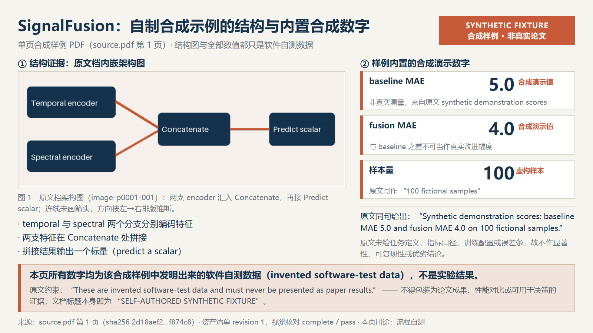
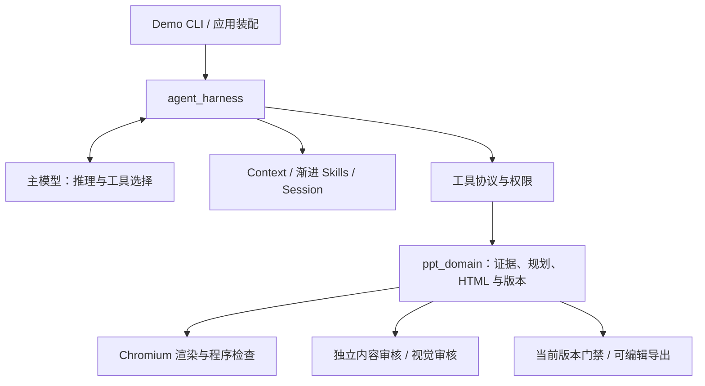

# PPT Agent Research

基于自主 Agent Harness 的学术演示文稿生成研究原型。展示模型如何自主选择工具、读取证据、制作 HTML、渲染、审核及修订，以及程序如何维护资源、版本和交付保护。

**No license：本仓库暂不选择开源许可证，用于研究原型展示。** 未提供通用的使用、修改或再分发授权；复制模块和第三方依赖的既有声明保留。见 [许可与发布说明](docs/PUBLISHING.md)。

[静态展示](showcase/index.html) · [真实 Demo 快照](showcase/demo-b-2026-11-13/README.md) · [架构](docs/ARCHITECTURE.md) · [发布收尾检查](docs/RELEASE_CLOSEOUT.md)

## 真实运行结果

自制单页 **SignalFusion 合成 PDF → 实际解析与资产核对 → Agent 自主规划和制作 → HTML 渲染及双维审核 → 可编辑 PPTX 导出**。展示文件均为原始字节，统计来自真实事件。



| 范围 | 实测结果 |
|---|---|
| 输入 | 一页自制 PDF，虚构测试数据，不是真实科研成果 |
| 页面 | HTML v3，程序检查及独立内容/视觉审核通过，1 项非阻断性提示 |
| 导出 | 1 页 PPTX：31 个可编辑文本、1 张独立图片、33 个其他形状 |
| 耗时 | 755.3 秒，12 分 35 秒，未超时 |
| 调用 | 33 次逻辑模型调用；39 次工具调用，5 次报错均保留 |
| Token | 累计输入 1,251,708 / 输出 38,150；输入缓存子集 1,155,072 |
| 最终验收 | PPTX 结构通过；PowerPoint 自动渲染失败，视觉一致性未验收 |

[PPTX](showcase/demo-b-2026-11-13/final.pptx) · [源 PDF](showcase/demo-b-2026-11-13/source.pdf) · [HTML](showcase/demo-b-2026-11-13/slide.html) · [统计](showcase/demo-b-2026-11-13/run-summary.json) · [工具轨迹](showcase/demo-b-2026-11-13/tool-trace.json)

缓存和推理是输入/输出的子集；累计量不是单次上下文。SDK 隐藏 HTTP 重试和费用未知，不按零计算。本次整体 **incomplete / export_requires_final_validation**，不以退出码或内部 delivery 的 pass 代替最终视觉验收。

## 架构



- agent_harness：通用 Agent Loop、工具、上下文、Skills、事件与 JSONL Session 恢复，不依赖 PPT 或 Web 框架。
- packages/ppt_domain：PDF Manifest、来源哈希、分页 Markdown、计划、资源打包、绑定、审核与导出状态。
- apps/api：应用装配服务，当前没有完整 HTTP 服务或 Web 产品。
- 模型选择下一步；程序执行确定性的保存、渲染和版本核验。没有将整个生命周期编码成固定 DAG，Demo 默认保留 full 工具能力。

本次实测 Qwen Flash 负责主 Agent/内容审核，DeepSeek Flash 负责 PDF/原图核验，豆包 Turbo 负责视觉审核。模型 ID 和账户权限见 .env.example，可用性不作跨账号保证。源码导航见 [架构文档](docs/ARCHITECTURE.md)。

## 安装

建议 Python 3.12、Node.js 20+。Windows 本地已验证，Linux CI 已配置但远端执行尚未验证。在仓库根目录执行：

```bash
python -m venv .venv
# PowerShell: .\.venv\Scripts\Activate.ps1
# macOS/Linux: source .venv/bin/activate
python -m pip install -c constraints-tested.txt -e "./agent_harness[all]" -e ./packages/ppt_domain -e ./apps/api -e ".[dev]"
npm ci
npx playwright install chromium
```

也可直接调用虚拟环境内的 Python，避免 PowerShell 脚本执行策略影响。依赖约束见 constraints-tested.txt / package-lock.json；requirements-tested.txt 是已验证环境快照。

复制 .env.example 为 .env，仅在本地填写 Key，不要提交真实值。Node/Chromium 通过 PATH、仓库依赖或模板中的可选覆盖定位。原始 PDF 模式还需独立安装 MinerU、配置可执行文件/模型缓存/设备；预制资产模式和 Demo C 不需要 MinerU。最终自动渲染依赖 **Windows + Microsoft PowerPoint COM**，不保证跨平台一致。

## Demo A：无需 Key 的静态展示

双击 showcase/index.html，或运行：

```bash
python tools/serve_showcase.py --port 8000
```

打开 http://127.0.0.1:8000。资源均在仓库，无遥测、外部脚本或模型请求。截图明确标为 HTML 渲染。

## Demo B：真实单页 Agent

预检不发模型请求，也不验证远端账户权限：

```bash
python -m demos.single_page --output outputs/preflight-01
```

配置自己的 Key 后选择一种模式；以下运行会产生真实模型费用，输出目录必须是新的：

```bash
# 预制自有资产/固定规划：不解析 PDF；默认范围到 HTML 审核
python -m demos.single_page --run --output outputs/prepared-01 --max-turns 18

# 原始自制 PDF：实际解析、自主规划、制作、审核并申请导出；最长 15 分钟
python tools/run_demo_b_timed.py --pdf showcase/demo-b-2026-11-13/source.pdf --output outputs/raw-01 --seconds 900 --export
```

启动器只负责正式入口、计时和日志，不替 Agent 写页面或批准状态。主模型 SDK 最多额外重试 3 次；时限/轮次不是金额硬限额，工具内部调用也可能计费。取消后供应商仍可能计费。

另开终端只读观察：

```bash
python tools/watch_demo_b.py --output outputs/raw-01 --watch
```

使用相同输入、输出目录和 --resume SESSION_ID 恢复；原始 PDF 模式还需同一 --pdf。原始日志留在 outputs，切勿直接上传。详见 [手动说明](docs/DEMO_B_手动测试说明.md) 和 [真实测试状态](docs/DEMO_B_TEST_STATUS.md)。

## Demo C：无需 Key 的离线机制演示

```bash
python -m demos.offline --output outputs/offline-01
```

FakeModel 重放预写工具请求和测试 HTML，真实 Harness 执行保存、Chromium 渲染、版本保护与 Session 恢复。预期 render_ok=true、session_restored=true、2 次预期拒绝，pptx_delivered=false。这是机制验证，不是真实模型生成质量或独立审核通过证明。

## 离线检查

```bash
python -m pip check
python -m pytest -q
python tools/check_environment.py
python tools/package_release.py --check
```

覆盖 FakeModel、程序合同、本地 Chromium/PptxGenJS，不调用付费模型。分类见 [测试说明](docs/TESTING.md)，本轮结果见 [发布收尾检查](docs/RELEASE_CLOSEOUT.md)。

## 已知限制

- 本次一页合成输入不证明复杂表格、公式、多页规划或真实论文整套交付稳定性。
- PowerPoint 渲染两次失败，根因未确认；结构可通过而最终视觉验收仍未完成，内部完成状态与验收范围差异如实保留。
- 模型审核仍有误报/漏报；复杂 CSS、字体替换可能影响导出保真。
- 单页约 12.6 分钟且累计 Token 较多，尚无高效整套生成证据；本次费用未知。
- 此前 npm 审计有 image-size / pptxgenjs 两个 high 受影响包条目，本轮未升级或重新联网审计。
- 当前为 No license，未添加 MIT、Apache 或 Unlicense；第三方声明仍保留。

当前冻结为研究 Demo，不再为发布扩大功能；不暗示已实现 Layout Ranker、生产级平台或稳定一键论文转 PPT。
