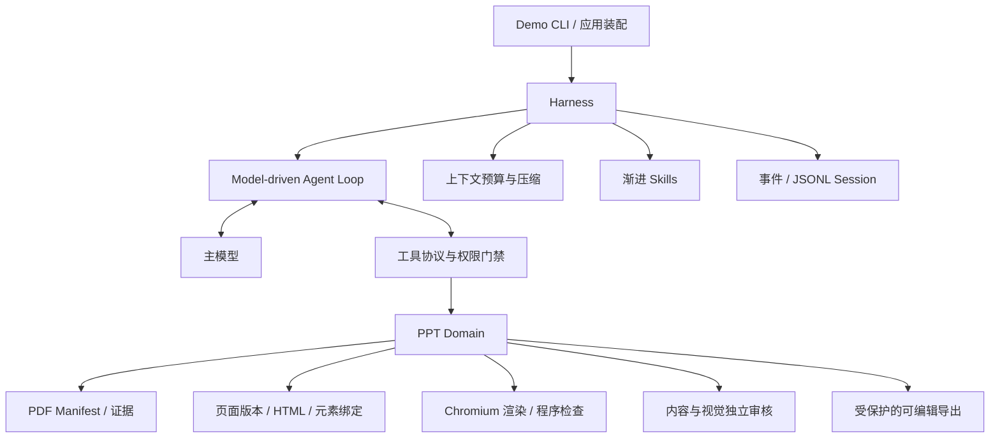

# 架构与调用关系

## 依赖方向

`agent_harness` 只依赖通用模型、工具和运行时，不依赖 PPT、Web 或 `apps/api`。`ppt_domain` 承担具体业务对象及工具；`apps/api/src/ppt_agent_api/services/agent_runtime.py::build_ppt_agent_harness` 组装模型、工具风险、串行写入集合、Skills、Session 和 Context。

真实 Demo 支持预制资产/固定规划与只有原始 PDF 的实际解析/自主单页规划两种模式，都调用同一个正式 Harness 入口。循环内部模型决定工具，启动脚本不代写 HTML、审核报告或状态位。`full` 工具集仍为默认，实验性的 `production` 配置保留但不默认启用，以免丢失上游恢复能力。

## 核心源码导航

| 机制 | 文件 / 主要入口 |
|---|---|
| Loop 与计量 | `agent_harness/src/agent_harness/core/loop.py`, `metering.py` |
| 模型与原生工具消息 | `core/models.py`, `messages.py`, `tools.py` |
| Harness 装配 | `runtime/harness.py::Harness.run` |
| 上下文与恢复 | `core/context.py`, `runtime/session.py` |
| 渐进 Skill | `runtime/skills.py::load_skills`, `make_skill_tool` |
| PDF 来源 | `packages/ppt_domain/src/ppt_agent_domain/pdf_assets/` |
| 领域合同与执行 | `presentation/tool_schemas.py`, `service.py` |
| 独立审核 | `presentation/slide_review.py` |
| 持久化和版本 | `presentation/storage.py` |
| 实际渲染 / PPTX | `presentation/runtime/render_html.mjs`, `html_to_pptx.mjs`, PowerShell COM 脚本 |

## 页面闭环

模型生成 HTML → `save_slide_binding(check_layout=True)` 保存版本/打包资源/绑定计划并尝试渲染检查 → `review_slide` 按当前版本分别保存内容及视觉报告。该闭环是可由模型选择的工具能力，不是强制 DAG。

修改 HTML、计划或源资产后，旧绑定/评审不可授权新版本导出。`export_editable_pptx` 检查正式状态，不能通过一个模型“已完成”的回答代替。最终 `render_pptx`、`validate_export` 和 `validate_delivery` 是不同验证层次，不能把低层 XML 测试等同于最终视觉验收。

## 模型与成本

主 Agent、内容审核、视觉审核、PDF 核验分别配置。真实调用通过现有 `model_call` 事件保留内部调用和使用量；Session JSONL 保留工具消息。缓存输入及推理输出通常是用量子集，不应再与输入输出相加。FakeModel 用量是本地估计，无真实费用。
